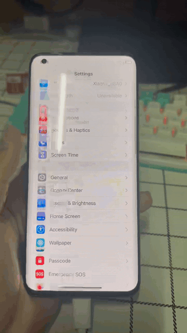
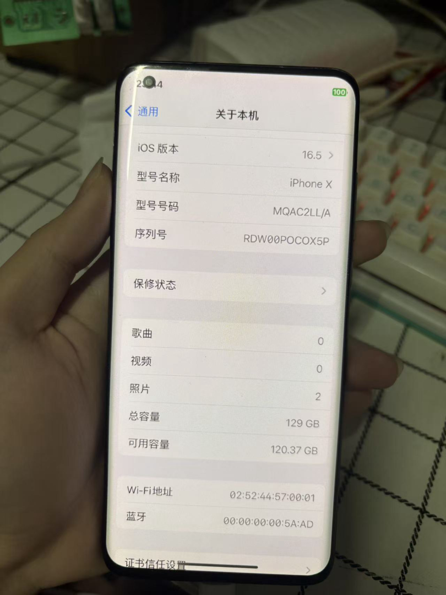
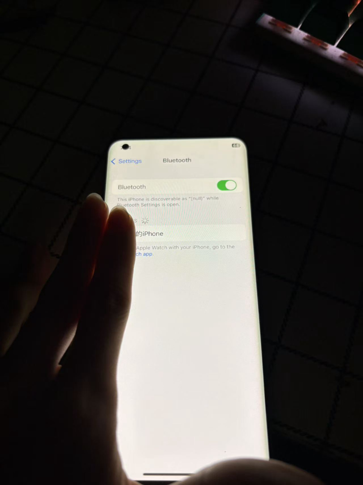

# HackiOS on Xiaomi Mi 10 Ultra

**Booting Apple's unmodified iOS 16.5 user space on a Snapdragon 865 Android phone.**

This repository ports the open-source **XNU kernel** (`xnu-8796.121.2`, the kernel that ships with iOS 16.5)
onto the **Xiaomi Mi 10 Ultra (`cas`, SM8250 / Snapdragon 865)** and runs the **unmodified iOS 16.5 user space**
on top of it — `launchd → logd → backboardd → SpringBoard → apps` — byte-for-byte as it ships from Apple.

<p align="center">
  
  
  
</p>

<p align="center">
  <em>Left to right: iOS 16.5 home screen with live gestures on the Mi 10 Ultra (see the
  <a href="docs/cas-homescreen.mp4">full video</a>) · “About” reporting a 129&nbsp;GB UFS data volume ·
  Bluetooth settings, discoverable and functional.</em>
</p>

---

## What this is

This is a **system-level porting project**: it replaces Apple's entire board-support layer — boot firmware,
platform drivers, GPU, Wi-Fi, storage, power — with custom work, while leaving the iOS programs, frameworks and
`dyld` shared cache completely untouched. Nothing is flashed; the phone boots over USB from RAM and returns to
Android after a reboot.

| | |
|---|---|
| **Target** | Xiaomi Mi 10 Ultra (`cas`), Qualcomm SM8250 (Snapdragon 865, 8 cores), 6 GB RAM, 1080×2340 AMOLED |
| **Guest OS** | iOS 16.5 (unmodified user space), XNU `xnu-8796.121.2` |
| **GPU** | Adreno 650 through Mesa 25.0.7 (`freedreno` FD650), OpenGL ES for CoreAnimation |
| **Storage** | UFS — an experimental **128 GiB data volume** backed by a custom block allocator |
| **Network** | QCA6390 Wi-Fi / Bluetooth (`ath11k` via LinuxKPI) |
| **Boot chain** | `fastboot boot` → UEFI (Project Silicium) → custom EFI loader → XNU |

## Highlights

- **Unmodified iOS on foreign silicon.** The iOS programs, frameworks and `dyld` shared cache are not changed by
  a single byte. What Apple's closed drivers used to do is reimplemented in the kernel, or provided by a library
  the kernel injects at load time (`DYLD_INSERT_LIBRARIES`).
- **Full Adreno 650 bring-up.** GMU / zap / SMMU firmware loading, 587 MHz clocks, and a Mesa `freedreno` FD650
  driver so SpringBoard's CoreAnimation renders through OpenGL ES on the GPU — not a software rasterizer.
- **Chinese localization end-to-end.** Complete language packs plus the full (untrimmed, 78 MB) PingFang font set
  injected into the system image, so Settings, the home screen and stock apps render Chinese correctly.
- **Real data persistence.** `/private/var` is checkpointed to the UFS-backed Darwin volume on shutdown and
  restored on boot (`var_store=1 ufs_write=1`) — photos and settings survive a reboot.
- **A 128 GiB UFS data volume.** A custom block allocator (bitmap-backed, persistent across sessions) presents a
  128 GiB volume to the kernel; “About” reports the full capacity, as shown above.
- **No vendor firmware redistributed.** Every binary blob (GPU, Wi-Fi, audio DSP, haptics) is pulled from the
  phone's own Android at setup time; the iOS system image is built on *your* machine from Apple's own IPSW.

## Works on the phone

| Working | Status |
|---|---|
| iOS 16.5 → SpringBoard home screen, widgets, dock | ✅ |
| Touchscreen (ST FTS521), multitouch, gestures, power/volume keys | ✅ zero errors over a full session |
| GPU hardware rendering (Adreno 650, Mesa FD650) | ✅ |
| Chinese + full PingFang font in system UI | ✅ |
| Wi-Fi / Bluetooth (QCA6390) | ✅ |
| Audio DSP (ADSP), haptics (AW8697), battery & charging (BQ28Z610 + BQ25790) | ✅ |
| Data persistence across reboot | ✅ |
| 128 GiB UFS data volume | ⚠️ experimental (see [mi10ultra](mi10ultra/README.md)) |

## Architecture

```
fastboot boot ──► UEFI (Project Silicium) ──► xnuloader (custom EFI application)
                                                │  resident: USB link (fastboot protocol),
                                                │  watchdog, receives the kernel's log
                                                ▼
        XNU kernel (BCM2837 reference config + our platform layer)
           ├─ GICv3, timer, video console, return-to-loader handoff
           ├─ APFS (images in RAM, iOS root volume on UFS), ramfs (/private/var)
           ├─ minicrypto in place of corecrypto; AMFI & Sandbox stand-ins (MAC policies)
           ├─ driver replacements: IOSurface, IOMobileFramebuffer, AppleKeyStore, network stack
           ├─ GPU: Adreno 650 · Wi-Fi: QCA6390 (ath11k / LinuxKPI) · sound: ADSP · input: FTS521
           ▼
        iOS 16.5 launchd → backboardd → SpringBoard → apps
```

## My contribution (Mi 10 Ultra port)

This repository builds on the **HackiOS / Project Silicium** ecosystem (see
[Acknowledgements](#acknowledgements)). The `cas` (Mi 10 Ultra) port is original work:

- **Device profile & platform layer** — `mi10ultra/cas-device/`, `common/devices/cas.conf`: DTB parsing, UEFI
  memory layout (`FD 0x9FC00000`, `PAYLOAD 0xF0000000`), and a `platform_cas` loader target.
- **Custom EFI loader** — `mi10ultra/loader/`, with `platform_cas`, a large-extent `darwin_file` transport, and
  the `hackios-board` device property.
- **Kernel drivers** — `hk_*.c` / `umi_*.c`: Adreno 650 GPU, QCA6390, ADSP audio, `hk_speaker.c` (CS35L41),
  touch, power, and a **UFS block allocator** (`hk_ufsvar.c`, 128 GiB geometry, 16 KiB pages).
- **Toolchain & build** — XNU cross-build on Linux (cctools, LLVM `ld64.lld`, Mesa `freedreno`), plus Windows
  WinUSB loader daemons and one-click boot scripts.
- **Reverse engineering** — the `TzDxeLA.efi` patch, RPMh `cmd-db` rail mapping, and firmware extraction from the
  phone's own vendor images.

A detailed, reproducible write-up lives in [`mi10ultra/README.md`](mi10ultra/README.md) and
[`mi10ultra/RELEASE-NOTES.md`](mi10ultra/RELEASE-NOTES.md).

## Repository layout

| Path | What |
|---|---|
| `mi10ultra/` | the `cas` port: device profile, loader, kernel drivers, patches, scripts, docs |
| `xnuloader/` | the EFI loader (`loader.c`, `mkpayload.py`) |
| `xnu/` | XNU patches and new files (`apply.sh` / `export.sh`) |
| `xnu-deps/`, `xnu-build.sh`, `xnu-env.sh` | building XNU on Linux |
| `uefi/`, `mkxnuimg.py` | the UEFI port and `fastboot boot` image packing |
| `wifi/lx/` | the layer that lets Linux's Wi-Fi driver build against our kernel |
| `qemu/` | QEMU runs, touch input, screenshots, stack symbolication |
| `tools/` | recording, UFS/flash tools, firmware fetch, host tests |
| `common/` | workspace setup, per-device build/run, device profiles |
| `prebuilt/`, `docs/` | built artifacts and documentation |

## Quick start

The fastest path runs the port in **QEMU** (no phone, no kernel build) — see the upstream workflow in
[`common/run.sh`](common/run.sh). For the **Mi 10 Ultra**, follow [`mi10ultra/README.md`](mi10ultra/README.md);
the required `system.apfs` (2.4 GB, Chinese) is built on your machine from Apple's IPSW and is therefore not
committed here (see the [releases](https://github.com/DBC1349/hackios-mi10ultra/releases)).

## Releases

Prebuilt kernel, loader payload and root images are attached to the
[releases](https://github.com/DBC1349/hackios-mi10ultra/releases) page. The system image is generated locally from
Apple's own CDN.

## Acknowledgements

Built on the **HackiOS / Project Silicium** ecosystem: the upstream
[hackios-xnu-kernel](https://github.com/oosexgang/hackios-xnu-kernel) and
[hackios-xnu-userland](https://github.com/oosexgang/hackios-xnu-userland) repositories, and the umi-line ports
[`JopangJovan/hackios-xnu-kernel-umi`](https://github.com/JopangJovan/hackios-xnu-kernel-umi) and
`hackios-xnu-userland-umi` (verified on the Xiaomi Mi 10). The `cas`-specific work in `mi10ultra/` is original.

## License

No Apple or vendor files are committed. `xnu/` is a derivative of XNU distributed under APSL 2.0; this repository
is released under the [Apple Public Source License 2.0](LICENSE). Third-party components (ath11k, FreeBSD
LinuxKPI, libzbitmap, libdeflate, UEFI drivers) keep their own licenses — see [prebuilt/NOTICES.md](prebuilt/NOTICES.md).

> iOS, iPhone and Apple are trademarks of Apple Inc. This is an independent research project, not affiliated with,
> authorised, or endorsed by Apple.
